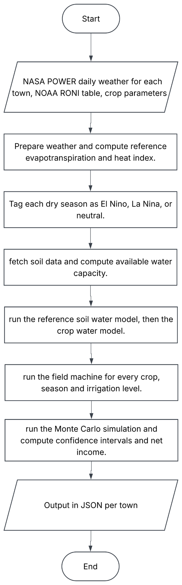
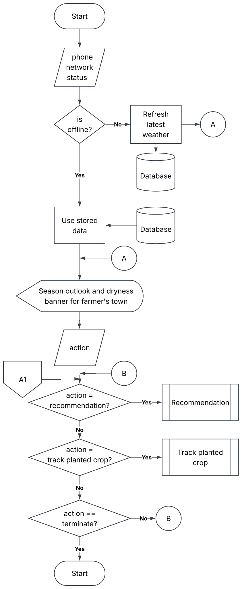
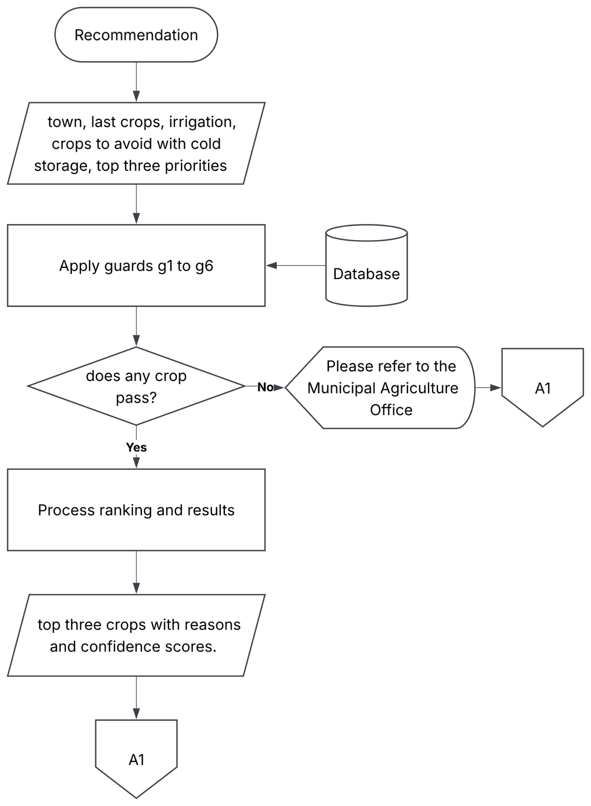
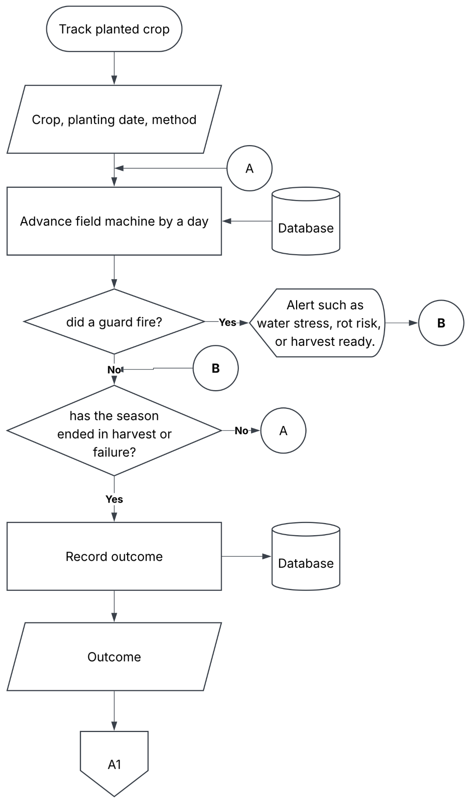
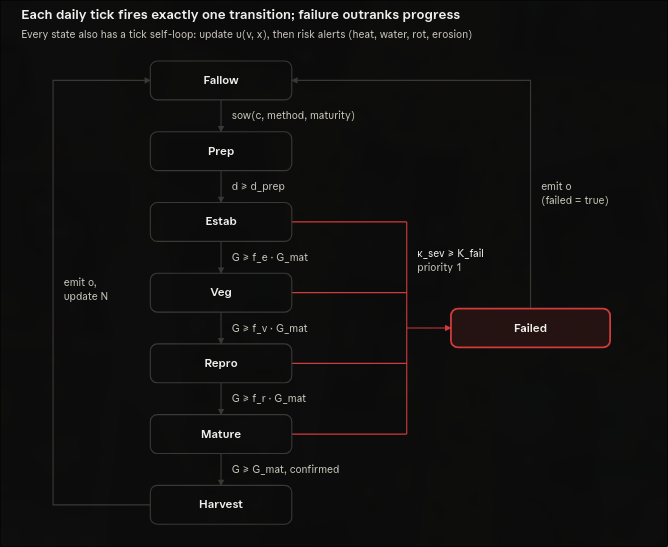
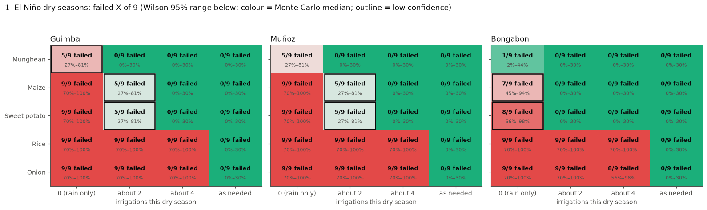
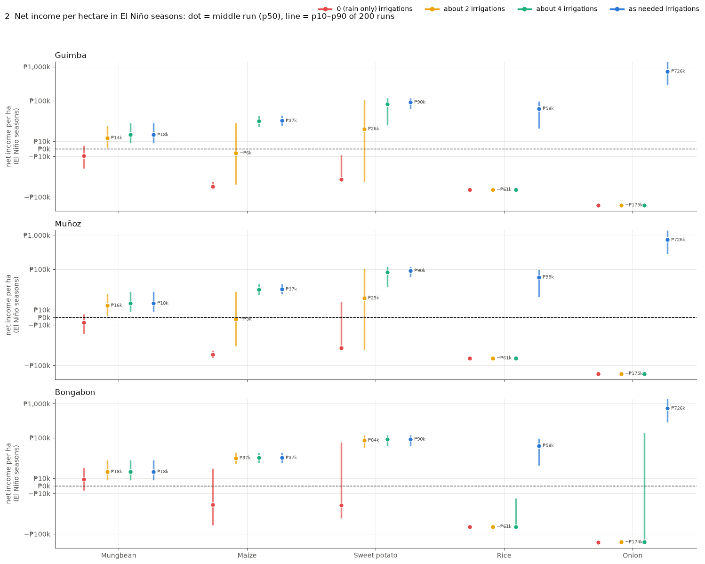
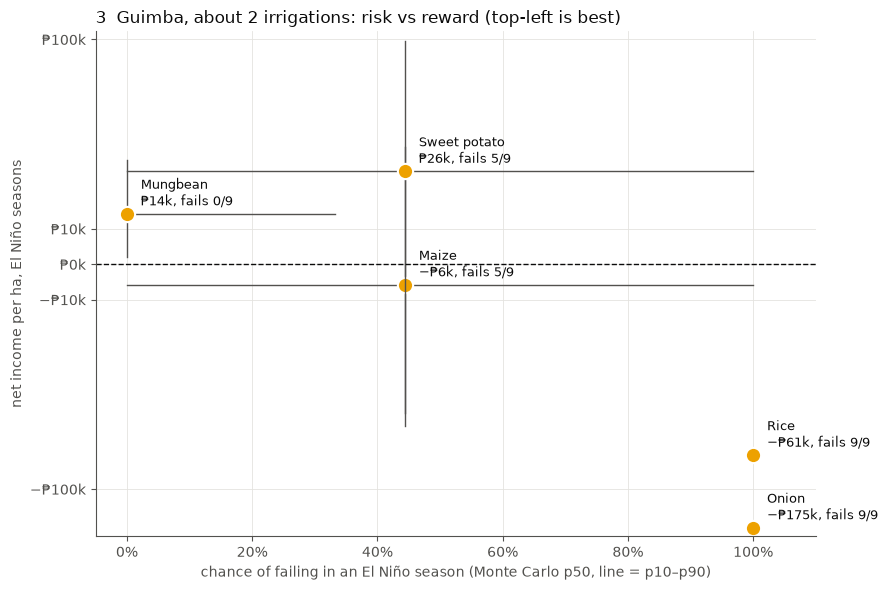
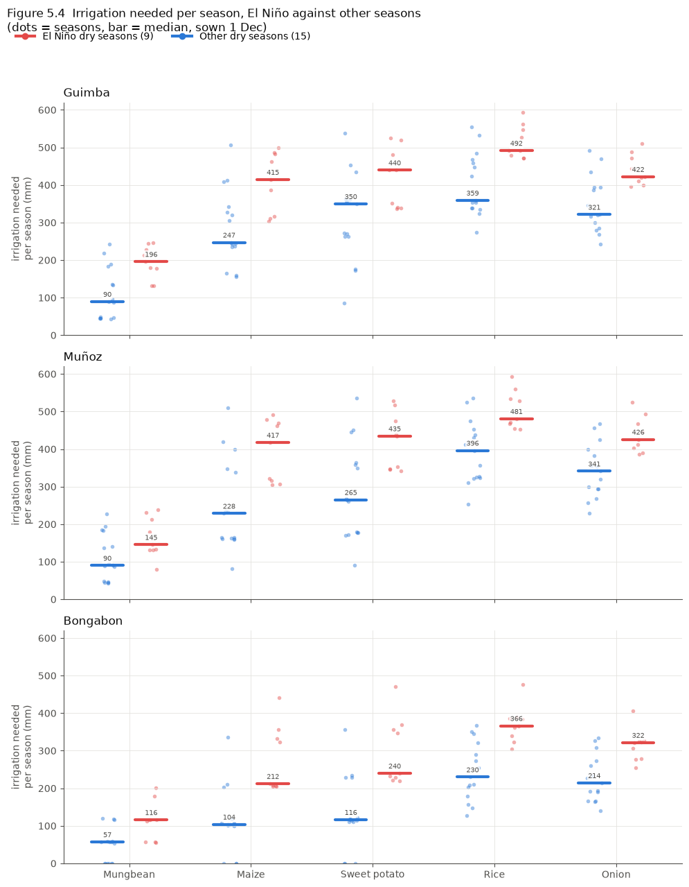
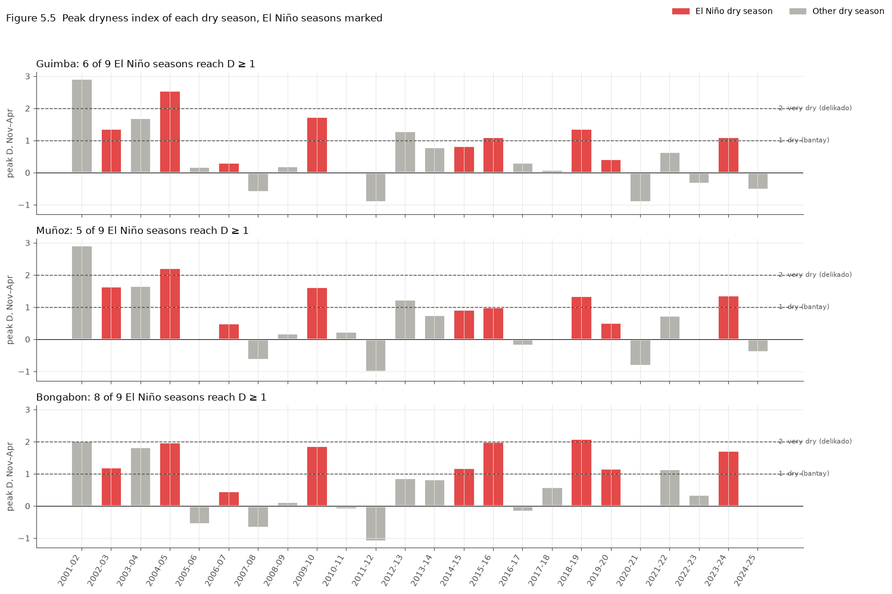

# Ani

**Crop planning and drought alerts for Nueva Ecija farmers during El Niño dry seasons.**

**Live web demo:** https://alyastanga.github.io/Ani/

Ani is an offline-first mobile app (Flutter, for Android and iOS, with a web build) built for the **NASA Space Apps Challenge**. It helps smallholder farmers in three towns of Nueva Ecija, Philippines (**Guimba**, **Science City of Muñoz** and **Bongabon**) decide what to plant in a dry season hit by El Niño. Once a crop is planted, the app tracks it and warns the farmer about water and heat problems. It works in **Filipino and English**.

> **Ani is advisory only.** It helps with a decision but guarantees nothing. Its estimates come from past weather and a simple field model, and conditions on a given farm can differ. Always check with the Municipal Agriculture Office (MAO) before you commit seed, labour or money.

---

## The problem

El Niño brings drier, hotter dry seasons to Central Luzon. A farmer who plants the wrong crop for the water they have can lose the whole season. Weather and climate data exist (NASA satellites, NOAA's El Niño index, global soil maps), but they don't reach the farmer in a form that answers one question: *what should I plant this season, given my town and my water?*

## What Ani does

- **Recommends a crop in five questions.** The farmer answers: which town, the last two crops, how many irrigations they can give, any crops they won't plant, and what matters most to them (low risk, saving water, income, soil, pests). Ani then shows up to **three crop cards**. If no crop is safe, it shows a **"Huwag munang magtanim"** (Hold: don't plant yet) screen with the reason and what to do instead.
- **Explains each suggestion.** Every card shows how often the crop failed in past El Niño years ("Failed in 0 of 9 El Niño years"), how much water it needs, an expected income range in PHP, and warnings such as "No cold storage: high price risk".
- **Shows the season outlook.** It gives the El Niño state, a monthly dryness index (Normal / Bantay / Delikado) and heat-safety advice ("Magtrabaho nang maaga", work early).
- **Tracks a planted crop.** The app follows the crop stage by stage (Prep → Establishment → Vegetative → Reproductive → Mature → Harvest) and alerts the farmer when to irrigate, when heat stress threatens flowering, about onion rot risk, a likely failure, or harvest time.
- **Includes a crop library.** It covers the five crops the model knows, Palay (rice), Sibuyas (onion), Munggo (mung bean), Mais (corn) and Kamote (sweet potato), with duration, water need and risk per town and irrigation level.
- **Works offline.** All recommendation data ships inside the app. When the phone is online, it can also fetch recent NASA POWER weather for the outlook and the tracker.
- **Has a season replay demo.** It replays past seasons so you can see the tracker and its alerts without waiting a real season.

## Research paper

Ani is the working system behind the paper **"Ani: An Extended Finite State Machine-Based Decision Support System for El Niño Dry-Season Crop Selection in Nueva Ecija"**, submitted to the NASA Space Apps Challenge, **Field Shift: Adapting Farms with NASA Data** (November 2026).

**Read the paper:** [`docs/paper/PAPER.md`](docs/paper/PAPER.md) (Markdown, with figures and equations), reproduced in full [below](#full-paper), or download the original [Word file](docs/Ani_NASA_Space_Apps_Challenge.docx).

**Why it was built.** Farmers choose their dry-season crop before they know how dry the season will be. They rely on fixed calendars and general El Niño advisories, which don't say what a drought means for a given crop on a farm with a given water supply. Free NASA, soil and market data are never turned into local advice. In November 2026 the July–September value of NOAA's Relative Oceanic Niño Index was +2.2, the highest since 2000 and above the +1.7 that preceded the 2015–2016 drought, so the signal for the coming dry season is strong.

**Objectives.**

1. Build a town-level dryness index and El Niño outlook that ranks the current season against 25 years of each town's own record.
2. Simulate daily soil water, growth stage, water stress, failure and irrigation need for rice, onion, mungbean, maize and sweet potato in every dry season from 2001 to 2025, under four levels of irrigation access.
3. Design a deterministic, deadlock-free planner, modelled as an extended finite state machine (EFSM), that removes unsuitable crops, ranks the rest by the farmer's priorities and explains each recommendation.
4. Quantify uncertainty with Wilson confidence intervals and a Monte Carlo simulation, and report the failure risk and net-income range on every recommendation.
5. Provide in-season alerts on dryness, crop water stress, heat at flowering, harvest timing and heat safety through an offline mobile app.

**Three state machines.** The system implements a *field machine* for the growing season, a *planner* that ranks crops from the farmer's answers, and an *alert machine* for the dryness banner.

**Who it is for.** Farmers get advice that matches their own water access and priorities. Municipal Agriculture Offices and the Department of Agriculture get a tool that shows the reasons and uncertainty behind each recommendation. The National Irrigation Administration and local governments can see how much irrigation each crop needs in an El Niño season.

### Scope

| | |
| --- | --- |
| **Towns** | Guimba (15.6623° N, 120.7657° E), Science City of Muñoz (15.7153° N, 120.9039° E), Bongabon (15.6321° N, 121.1459° E), one point each |
| **Season** | Dry season, November to April; baseline 2001–2025 |
| **Crops** | Rice, red onion, mungbean, yellow maize, sweet potato (sown 1 December ±15 days) |
| **Irrigation levels** | None, about two, about four, as needed |
| **Uncertainty** | Wilson confidence intervals; Monte Carlo with 200 runs |

### Delimitations

- Only drought and heat linked to El Niño are modelled. Flood, typhoon, erosion, pests and disease are not.
- Results describe one point per town, not individual fields or barangays. Guimba and Muñoz share one NASA POWER weather cell for temperature.
- Only five crops, and crop-level advice only: varieties are not compared. Peanut, sorghum and watermelon were left out for lack of local data.
- Labour is not a criterion, except inside the PSA production cost.
- Irrigation is only the number of times a farmer can irrigate. Canal schedules, pump capacity and water cost are not modelled. Rice is modelled as an upland crop, so its water need is a lower bound.
- Yields and prices are provincial averages, and costs are regional or national averages from different years. Net income ignores partial yield loss short of crop failure.
- Crop failure is defined as ten or more consecutive days of severe water stress, a calibration choice and not a published threshold. Heat damage at flowering is evaluated for rice only.
- No field trials. Validation uses satellite data, published crop durations and agricultural statistics.

### Proponents

- Sean Anikin Coquia
- Peter Dela Cruz
- Hanz Laurence Mapua
- Kurt Laurence Raneses
- Aaron Angelo Ragudos
- Jerick Anthony Remo

## How it works

```
NASA POWER weather + NOAA RONI + ISRIC SoilGrids + crops.csv (PSA yields & prices)
        |  pipeline/ (Python)
        v
pipeline/data/export/ani_<town>.json   (one bundle per town)
        |  copied to
        v
app/assets/data/ani_guimba.json, ani_munoz.json, ani_bongabon.json
        |  app/lib/data/bundle.dart (typed loader)
        v
app/lib/core/  planner, field machine, dryness, ET0, alerts (Dart ports)
        v
app/lib/features/  questionnaire -> result / Hold, outlook, crops, My farm
```

1. **Weather and climate.** The pipeline reads 2001–2025 daily weather from NASA POWER for each town. It computes reference evapotranspiration (ET₀) and heat index, and tags each dry season as El Niño, neutral or La Niña using NOAA's RONI index.
2. **Dryness.** It computes SPI/SPEI-style drought indices per month.
3. **Soil water.** A daily soil water balance uses soil water-holding capacity from ISRIC SoilGrids.
4. **Field state machine.** It simulates every crop in every past season, at every irrigation level, through its growth stages, and records whether the crop reached harvest or failed.
5. **Risk and income.** It estimates failure rates with Wilson confidence intervals and builds net-income ranges with Monte Carlo sampling over yield, price and cost.
6. **Planner.** It applies safety guards (failure risk too high for the water supply, crop rotation, cold storage for onion), then ranks the remaining crops with **TOPSIS** using the farmer's priorities.
7. **The app** ships the results as JSON and runs the same planner, field machine and alert logic in Dart on the phone. Fixture tests check that the Dart results match the Python reference.

## Data sources

| Source | Used for | Where |
| --- | --- | --- |
| [NASA POWER](https://power.larc.nasa.gov/) daily point data | Weather history (pipeline) and live in-season top-up (app, optional) | Pipeline and app |
| [NOAA CPC RONI](https://www.cpc.ncep.noaa.gov/products/analysis_monitoring/enso/roni/) | El Niño / La Niña state per season | Pipeline |
| [ISRIC SoilGrids](https://soilgrids.org/) | Soil water retention | Pipeline |
| PSA OpenSTAT / PalayStat | Crop yields and farm-gate prices (`crops.csv`) | Pipeline |
| NASA AppEEARS (SMAP, MODIS) | Optional model validation only | Notebooks |

The app calls only one API at runtime, NASA POWER. It needs no key, no account and no backend.

## Tech stack

- **App:** Flutter / Dart (SDK ^3.13), `shared_preferences`, `http`, `flutter_local_notifications`, `fl_chart`, `intl`, Flutter localizations (English and Filipino)
- **Pipeline:** Python 3.11+, pandas, numpy, scipy, requests, matplotlib, pytest
- **Hosting:** GitHub Pages for the web demo (`gh-pages` branch)

## Repository layout

```
app/                 Flutter app
  assets/data/       ani_<town>.json bundles shipped with the app
  assets/fixtures/   Python-generated expected values for parity tests
  lib/core/          planner, field machine, alert machine, ET0, heat index, dryness
  lib/data/          bundle loader, NASA POWER client, local storage, notifications
  lib/features/      onboarding, home, recommend, outlook, library, farm, alerts, about
  lib/l10n/          English and Filipino strings
  lib/theme/         colours, fonts and shared widgets
  test/              unit, parity and widget tests
pipeline/            Python data pipeline (see pipeline/README.md)
notebooks/           exploration, Monte Carlo and figure notebooks
docs/
  paper/PAPER.md     the research paper (Markdown) with its images
  Ani_NASA_Space_Apps_Challenge.docx   the research paper (Word original)
  PLAN.md            build plan and design decisions
  DEMO.md            five-minute demo script
```

## Getting started

### Requirements

- [Flutter SDK](https://docs.flutter.dev/get-started/install) with Dart ^3.13, to run the app
- Python 3.11 or newer, to run or test the pipeline

### Run the app

```bash
cd app
flutter pub get
flutter run            # on an emulator, simulator, connected phone or Chrome
```

### Test the app

```bash
cd app
flutter analyze
flutter test
```

### Build a release APK

```bash
cd app && flutter build apk --release
# output: app/build/app/outputs/flutter-apk/app-release.apk
```

### Build the web version (GitHub Pages)

The site is served from the `gh-pages` branch under `/Ani/`, so build with that base path:

```bash
cd app && flutter build web --release --base-href /Ani/
# output: app/build/web/  (publish its contents to the gh-pages branch)
```

### Run the pipeline

```bash
python -m venv .venv && source .venv/bin/activate
pip install pandas numpy scipy requests matplotlib pytest
python -m pytest pipeline/tests
```

Get a reference recommendation from the command line. It should match the app:

```bash
python pipeline/planner.py --muni guimba --water limited_2 --last rice rice --priorities risk water income
```

To rebuild the data bundles from raw data, follow the steps in [`pipeline/README.md`](pipeline/README.md).

## Demo

Try it at **https://alyastanga.github.io/Ani/**, or follow the five-minute script in [`docs/DEMO.md`](docs/DEMO.md). It covers:

1. Guimba, rain only → **Hold** (no crop is safe)
2. Guimba, about 2 irrigations → **Munggo**
3. Bongabon, irrigate as needed → Munggo, Kamote, **Sibuyas** with a cold-storage warning
4. Season replay of a past planting with its stage changes and alerts

## Limits

- Advisory only. Ani is not agronomic or financial advice and does not replace the MAO.
- It covers three towns and five crops only. The El Niño state for the coming season, and all other data, come from the bundles built at the last pipeline run.
- Income, water and failure-risk figures are estimates from 2001–2025 history and may be far from what a given farm sees (see the ranges on each card).
- The model covers only El Niño drought and heat, with one point per town and no field trials. See the paper's delimitations above.
- Season replay shows past seasons only. Its alerts are not live and are never saved.

---

## Full paper

*Ani: An Extended Finite State Machine-Based Decision Support System for El Niño Dry-Season Crop Selection in Nueva Ecija.* NASA Space Apps Challenge, Field Shift: Adapting Farms with NASA Data, November 2026. Proponents: Sean Anikin Coquia, Peter Dela Cruz, Hanz Laurence Mapua, Kurt Laurence Raneses, Aaron Angelo Ragudos, Jerick Anthony Remo.

### Chapter 1: The Problem and Its Background


#### Introduction

El Niño is a periodic warming of the central and eastern Pacific Ocean that changes rainfall across the tropics. In the Philippines, an El Niño year often brings a drier and hotter dry season, which falls on the months when farmers grow their second crop of the year. For farming households, the decision of what to plant in that season is made before the weather is known, and a wrong choice can mean a failed crop, lost inputs and a lost income.

Nueva Ecija is one of the country's main rice-producing provinces, and its farmers have long relied on irrigation from the National Irrigation Administration and on their own experience to decide what to plant. As El Niño events grow more frequent in public discussion and irrigation supply becomes less certain in drought years, farmers need information that is specific to their town, their water access and the crops they can actually grow.

This study develops Ani, a decision support system that recommends what to plant in the dry season of an El Niño year in three Nueva Ecija municipalities: Guimba, the Science City of Muñoz and Bongabon. Ani combines NASA satellite and weather data, soil data, crop water requirements and local farm prices into a simulation of every dry season from 2001 to 2025. It then ranks crops according to the farmer's own water access and priorities, explains each recommendation and states how certain it is. The decision logic is built as an extended finite state machine, a model that is deterministic, never leaves the farmer without an answer and records the reason for every step it takes.

#### Introduction

The effect of El Niño on Philippine rainfall depends on the season. During an El Niño, rain from July to September can be above normal, and the dry signal arrives in the months that follow (Lyon et al., 2006). In Luzon, rice production from January to June moves with the state of the Pacific Ocean during the preceding July to September (Roberts et al., 2009). This means that by October, before the dry-season crop is planted, there is already a useful signal about the coming season. In November 2026 that signal was strong: the July to September value of NOAA's Relative Oceanic Niño Index is +2.2, the highest July to September value since 2000, above the +1.7 that preceded the 2015 to 2016 drought.

The dry season in Nueva Ecija runs from November to April. Over the 2001 to 2025 record used in this study, rainfall from January to April averages less than a third of the evaporative demand in Guimba and Muñoz and less than half in Bongabon, so dry-season crops depend almost entirely on stored soil water and irrigation. When El Niño reduces rain further or irrigation supply is cut, farmers face a choice between their usual crop, often rice, and crops that use less water, such as mungbean, maize or sweet potato. These crops differ greatly in how much water they need, how long they take to mature, how much they earn and how often they fail.

Public drought advisories in the country are issued at national or regional scale and describe the weather rather than its consequence for a particular crop on a particular farm. A farmer in Guimba with two possible irrigations and a farmer in Bongabon with a reliable canal face very different risks from the same El Niño. Satellite and reanalysis data from NASA, global soil maps and Philippine agricultural statistics are freely available, but they are not combined into advice that a farmer or a Municipal Agriculture Office technician can act on. This gap between available data and usable advice prompted the study.

#### Statement of the Problem

Farmers in Guimba, the Science City of Muñoz and Bongabon choose their dry-season crop before they know how dry the season will be. They rely on fixed planting calendars, general El Niño advisories and their own experience, none of which state what an El Niño season means for a given crop on a farm with a given water supply. Freely available NASA, soil and agricultural data are not turned into local advice, so a farmer may plant a water-hungry crop in a drought year and lose both the harvest and the money spent to grow it.

To address these challenges, this study aims to answer the following specific problems:

1\. The lack of a town-level measure of how dry the coming dry season is likely to be compared with past years, since available drought advisories are national or regional and describe weather rather than local conditions.

2\. The absence of crop-specific information on how an El Niño dry season affects water stress, crop failure, water need and harvest date for each crop under the farmer's actual irrigation access.

3\. The reliance on fixed calendars and unexplained advice that ignores the farmer's own priorities, constraints and recent crops, and that gives no reason for what it recommends.

4\. The absence of any statement of uncertainty in crop advice, which hides that El Niño years are few, that crop and price inputs vary, and that a high-income crop can also carry a high risk of loss.

5\. The lack of timely warnings during the season that are tied to the farmer's own crop and its growth stage, such as when the crop needs water, when heat threatens flowering and when the crop is ready for harvest.

#### Objectives of the Study

The general objective of this study is to design and develop Ani, a decision support system that recommends dry-season crops for El Niño years in Guimba, the Science City of Muñoz and Bongabon, Nueva Ecija, using NASA data, crop water models and local farm statistics.

Specifically, this study aims:

1\. To build a town-level dryness index and El Niño outlook from NASA POWER weather and NOAA ocean data that ranks the current season against 25 years of each town's own record.

2\. To simulate, for every dry season from 2001 to 2025, the daily soil water, growth stage, water stress, failure and irrigation need of rice, onion, mungbean, maize and sweet potato under four levels of irrigation access.

3\. To design a deterministic and deadlock-free planner, modeled as an extended finite state machine, that removes crops unsuitable for the farmer, ranks the rest by the farmer's own priorities and explains each recommendation.

4\. To quantify the uncertainty of each recommendation through Wilson confidence intervals and a Monte Carlo simulation, and to report the risk of failure and the range of net income on every recommendation.

5\. To provide in-season alerts on dryness, crop water stress, heat at flowering, harvest timing and heat safety, generated by the same models and delivered through an offline mobile application.

#### Significance of the Study

The study is significant because it turns freely available satellite, weather, soil and market data into crop advice that a farmer can act on before an El Niño dry season. It shows that a transparent rule-based model, built on established methods for drought measurement and crop water use, can give town-level advice with a stated level of confidence. In doing so, it contributes a working example of how NASA Earth observation data can support decisions at the scale of a single farm.

The farmers of Guimba, the Science City of Muñoz and Bongabon may benefit from advice that matches their own water access and priorities. Instead of a general warning, a farmer learns which crops have survived past El Niño seasons with the amount of irrigation they actually have, how much water each crop needs and what it is likely to earn. The explanation attached to each recommendation and the advice to hold off planting when no crop is safe may help farmers avoid losing their inputs in a failed season.

The Municipal Agriculture Offices and the Department of Agriculture may benefit from a tool that supports their extension work. Technicians can see the reasons and uncertainty behind each recommendation, identify farmers whose water access leaves no safe crop, and focus assistance where the risk of loss is highest. The season outlook and dryness banner may also support the timing of local advisories.

The National Irrigation Administration and local government units may use the results to understand how much irrigation each crop needs in an El Niño season and how much difference two or four irrigations make. This information may support planning when irrigation water must be rationed among farmers.

The proponents may benefit from applying automata theory, numerical simulation, statistics and software engineering to a real agricultural problem. The project required the integration of several data sources, the translation of published scientific methods into tested code and the design of a state machine that can be verified and explained.

The future researchers may use the study as a reference for decision support systems in agriculture and climate adaptation. The method, the data pipeline and the documented limitations provide a starting point for extending the work to other municipalities, other crops, field validation and other climate hazards.

Overall, the study seeks to help farmers make better-informed planting decisions in El Niño years, reduce avoidable crop losses and show how open scientific data can be made useful at the local level.

#### Scope and Delimitations

#### Scope

The study covers three municipalities of Nueva Ecija, represented by one point each: Guimba at 15.6623° N, 120.7657° E, the Science City of Muñoz at 15.7153° N, 120.9039° E and Bongabon at 15.6321° N, 121.1459° E. It covers the dry season from November to April and a baseline of 25 years, from 2001 to 2025. The crops studied are rice, red onion, mungbean, yellow maize and sweet potato, sown on 1 December with a spread of 15 days either way.

The study uses daily weather, satellite rainfall and modeled soil wetness from NASA POWER; the Relative Oceanic Niño Index from NOAA; soil water retention from ISRIC SoilGrids; crop coefficients, root depths and stage lengths from FAO Irrigation and Drainage Paper 56; crop durations and base temperatures from Philippine and international crop guides; and yields, farmgate prices and production costs from the Philippine Statistics Authority.

The study computes a monthly dryness index, simulates the daily soil water and growth of each crop in every dry season under four irrigation levels of none, about two, about four and as needed, and records crop failure, water need, harvest date and net income. It quantifies uncertainty with Wilson confidence intervals and a Monte Carlo simulation of 200 runs. It implements three extended finite state machines: a field machine for the growing season, a planner that ranks crops from the farmer's answers, and an alert machine for the dryness banner. The outputs are recommendation cards with explanations, a season outlook, a dryness banner, in-season crop alerts and heat safety tips, packaged as one data file per town for an offline mobile application.

#### Delimitations

The study is limited to drought and heat associated with El Niño. Flood, typhoon, erosion, pest outbreaks and plant diseases are not modeled.

The study is limited to one point per municipality. Its results describe conditions at that point and cannot describe individual fields, barangays or areas across the municipality. Guimba and Muñoz share one NASA POWER weather cell for temperature, and the Bongabon cell includes foothills at about 282 meters.

The study is limited to the five crops named above and to crop-level advice. Varieties are not compared, and their differences enter only as ranges in the Monte Carlo simulation. Peanut, sorghum and watermelon were excluded for lack of local data.

The study does not include labour as a criterion. Labour cost appears only inside the production cost reported by the Philippine Statistics Authority, and labour availability is not considered.

Irrigation is represented only by the number of times a farmer can irrigate in a season. Canal schedules, pump capacity and the cost of water are not modeled. Rice is modeled as an upland crop without a flooded field, so its water need is a lower bound.

Yields and prices are provincial averages, and production costs are regional or national averages from different years. Net income does not account for partial yield loss from stress short of crop failure. Farm budgets of individual farmers are not used.

Crop failure is defined by a calibration rule of ten or more consecutive days of severe water stress during growth or flowering, which is a design choice and not a published threshold. Heat damage at flowering is evaluated only for rice, the only crop with a published critical temperature in the sources used.

The study does not conduct field trials. Validation relies on satellite data, published crop durations and agricultural statistics. Recommendations are advisory, and farmers with low-confidence results or no safe crop are referred to their Municipal Agriculture Office.The study is limited to drought and heat associated with El Niño. Flood, typhoon, erosion, pest outbreaks and plant diseases are not modeled.

The study is limited to one point per municipality. Its results describe conditions at that point and cannot describe individual fields, barangays or areas across the municipality. Guimba and Muñoz share one NASA POWER weather cell for temperature, and the Bongabon cell includes foothills at about 282 meters.

The study is limited to the five crops named above and to crop-level advice. Varieties are not compared, and their differences enter only as ranges in the Monte Carlo simulation. Peanut, sorghum and watermelon were excluded for lack of local data.

The study does not include labour as a criterion. Labour cost appears only inside the production cost reported by the Philippine Statistics Authority, and labour availability is not considered.

Irrigation is represented only by the number of times a farmer can irrigate in a season. Canal schedules, pump capacity and the cost of water are not modeled. Rice is modeled as an upland crop without a flooded field, so its water need is a lower bound.

Yields and prices are provincial averages, and production costs are regional or national averages from different years. Net income does not account for partial yield loss from stress short of crop failure. Farm budgets of individual farmers are not used.

Crop failure is defined by a calibration rule of ten or more consecutive days of severe water stress during growth or flowering, which is a design choice and not a published threshold. Heat damage at flowering is evaluated only for rice, the only crop with a published critical temperature in the sources used.

The study does not conduct field trials. Validation relies on satellite data, published crop durations and agricultural statistics. Recommendations are advisory, and farmers with low-confidence results or no safe crop are referred to their Municipal Agriculture Office.

### Chapter 2: Systems Design and Review of Related Literature


This chapter presents the system design and architecture of Ani, a decision support system that recommends dry-season crops for El Niño years in Guimba, the Science City of Muñoz and Bongabon, Nueva Ecija. It explains how the system turns NASA weather and satellite data, soil data, crop water requirements and Philippine farm statistics into town-level crop recommendations, a season outlook, a dryness banner and in-season crop alerts delivered through an offline mobile application. To illustrate these processes clearly, the chapter outlines the data pipeline and the farmer’s use of the application with procedural flowcharts. It uses IPO to detail the input process and output of the system. It also provides the review of related literature and synthesis to support the system’s idea.

#### Data Pipeline of the Proposed System



*Figure 1 Data Pipeline*

#### Procedural Flowchart of the Proposed System



*Figure 2 Start*

Shows a farmer the current alert for season outlook and dryness for their town and asks them what action they’d like to take in the app.



*Figure 3 Recommendation*

Recommends to the farmer which crops they can plant, based on the inputs they provide. Before ranking, the app checks every crop against six guards. Guard g1 removes crops that are not grown in the dry season. Guard g2 removes a crop that failed in more than half of past El Niño seasons at the farmer’s irrigation level. Guard g3 keeps onion for farmers without cold storage but adds a warning about price risk. Guard g4 removes crops the farmer said they will not plant. Guard g5 removes a crop that had damaging heat at flowering in half or more of past seasons. Guard g6 removes a crop that is expected to lose money. If no crop passes, the app tells the farmer not to plant yet (“Huwag munang magtanim”), names the reason, and advises them to consult their Municipal Agriculture Office.



*Figure 4 Track planted crop*

Follows the farmer’s logged crop day by day, from the planting date until harvest or failure. The farmer enters the crop, the planting date and the method of planting. Each day, the app advances the field machine by one day using the latest weather and the crop’s parameters. It updates the crop’s growth stage, soil water and stress counts, and checks whether any condition has been met. When one has, the app sends the matching alert: the crop needs water, heat threatens flowering, onion is at risk of rot after heavy rain, the crop has failed, or the crop is ready for harvest. The tracking continues until the season ends in harvest or failure. The app then records the outcome, which is used for the farmer’s next recommendation.

#### Input Process Output (IPO)

<table>
<colgroup>
<col style="width: 33%" />
<col style="width: 33%" />
<col style="width: 33%" />
</colgroup>
<thead>
<tr class="header">
<th>Input</th>
<th>Process</th>
<th>Output</th>
</tr>
<tr class="odd">
<th>25 years of NASA weather for each town, the soil map, crop guides, PSA yields and farmgate prices</th>
<th><p>25 years of NASA weather for each town, the soil map, crop guides, PSA yields and farmgate prices</p>
<p>Before release, Ani replays every crop in every past dry season, once with rain only and once with irrigation</p></th>
<th>A ready-made table of how each crop fared in each town, stored in the app</th>
</tr>
<tr class="header">
<th>NOAA's July–September Pacific temperature number</th>
<th><p>Ani checks whether the coming dry season is El Niño, La Niña or neutral</p>
<p>An October notice: "Inaasahan ang El Niño ngayong tag-araw", and a prompt to plan</p></th>
<th>An October notice: "Inaasahan ang El Niño ngayong tag-araw", and a prompt to plan</th>
</tr>
<tr class="odd">
<th>The farmer's five answers: town; last two crops; water source and how many times they can irrigate this dry season (0, about 2, about 4, or as needed); crops they won't plant and cold storage; top 3 priorities</th>
<th>Ani removes crops that cannot work for this farmer, then ranks the rest by the farmer's own priorities using the past-season table</th>
<th>Three crop cards, each with "X sa Y taon" risk, water needed, income range, a "Bakit?" reason and a confidence level. If nothing works: "Huwag munang magtanim", the reason, and "Kumonsulta sa MAO"</th>
</tr>
<tr class="header">
<th>The latest NASA rain, temperature and soil wetness for the town</th>
<th>Every 10 days, Ani compares this season's dryness with the same weeks in the past 25 years</th>
<th>A banner: Normal, Bantay ("Mag-ingat") or Delikado, plus "the driest r of n years"</th>
</tr>
<tr class="odd">
<th>The farmer's crop, planting date and method (optional)</th>
<th>Each day, Ani tracks the field's soil water and the crop's growth stage</th>
<th>Reminders: water now, heat at flowering, rot risk for onion, harvest window</th>
</tr>
<tr class="header">
<th>Daily temperature and humidity</th>
<th>Ani computes the heat index</th>
<th>"Magtrabaho nang maaga" on dangerous heat days</th>
</tr>
</thead>
<tbody>
</tbody>
</table>

*Figure 5 Input Process Output*

#### Review of Related Literature

El Niño does not dry the Philippines evenly through the year. Lyon et al. (2006) found that its effect on rainfall reverses with the season: the months from July to September can even be wetter than usual, while the dry signal arrives later and lasts into the following dry season. Roberts et al. (2009) showed that rice production in Luzon from January to June follows the state of the Pacific Ocean in the preceding July to September. Together, these studies explain why Ani reads the El Niño signal in July to September and applies it to the dry season that follows.

NOAA's Climate Prediction Center measures El Niño with the Relative Oceanic Niño Index, which compares sea temperatures in the central Pacific with the average of the whole tropical ocean, so that general ocean warming does not make every recent year look like El Niño (NOAA Climate Prediction Center, 2026). An El Niño episode is declared when the index stays at or above +0.5 °C for at least five overlapping three-month seasons.

A dry month in itself says little; what matters is how dry it is compared with the same month in other years. The Standardized Precipitation Index expresses rainfall as a standard score against a town's own history and handles the many months with no rain at all, which a simple average cannot (Svoboda et al., 2012). The same guide recommends at least 20 to 30 years of data, which the 25-year record in this study meets. The Standardized Precipitation Evapotranspiration Index applies the same idea to rainfall minus the water demand of the air, so it also captures the effect of heat (Vicente-Serrano et al., 2010). Because El Niño seasons are both drier and hotter, Ani uses this second index.

The standard method for estimating how much water crops use is FAO Irrigation and Drainage Paper 56 (Allen et al., 1998). It gives the Penman–Monteith equation for the water demand of a reference grass, crop coefficients that scale this demand to each crop and growth stage, and a soil water balance that tells when a crop begins to suffer from lack of water. The same publication lists rooting depths, the share of soil water each crop can use before stress begins and typical lengths of growth stages, which Ani adopts. How much water the soil can hold comes from SoilGrids, a global soil map with estimates of uncertainty (Poggio et al., 2021).

Crops develop faster in warm weather, so the length of a growth stage is better measured by accumulated heat, known as growing degree days, than by calendar days. Base temperatures for this purpose are published in extension guides from the University of Florida and the Midwestern Regional Climate Center. Heat also damages crops directly: Jagadish et al. (2007) found that one hour or more at 33.7 °C or higher during flowering caused rice spikelets to become sterile. Ani therefore counts hot days during flowering separately from the heat index, which describes comfort for people rather than harm to plants.

Legumes such as mungbean add nitrogen to the soil through biological fixation (Herridge et al., 2008), although harvested grain removes much of it, so the net gain is often small (Peoples et al., 2009). For irrigated rice, alternate wetting and drying has been adopted in the Philippines as a way to use less water (Lampayan et al., 2015). These findings shape the soil criterion and the treatment of rice as the crop that needs the most water.

Farmers find it easier to rank what matters to them than to give each criterion a numeric weight. Barron and Barrett (1996) showed that rank-order centroid weights, computed from a ranking alone, give decisions close to those made with the decision maker's true weights. Ani asks farmers to rank their top three priorities and converts the ranking into weights in this way.

An extended finite state machine adds variables, conditions and updates to a small set of named states (Cheng & Krishnakumar, 1993). This suits a cropping season, which has a few clear stages such as establishment, growth, flowering and maturity, and a few running quantities such as soil water and accumulated heat that decide when each stage ends. The same structure makes the model testable, since every transition can be listed and checked.

#### Synthesis

Each method used in this study is established in its own field: drought indices, the FAO-56 water balance, heat-driven crop development, rank-based weighting and extended finite state machines. What the reviewed literature does not provide is a single, explainable chain that runs from open NASA data to a town-level crop recommendation for El Niño dry seasons, with the risk and uncertainty stated for each crop. Ani provides that chain.

### Chapter 3: Data and Usage


Ani uses seven sources of data. All of them are sampled at, or summarized for, the three study points, and every value used in a calculation can be traced to its source. This chapter describes each dataset, what each variable means and where it is used.

#### Study Points

Each municipality is represented by its town center, taken from PhilAtlas for Guimba and Bongabon and from Wikipedia for the Science City of Muñoz. Working with points rather than maps keeps the data small and every calculation traceable, which matters for a mobile application that must work offline.

| Municipality          | Latitute | Longitude |
|-----------------------|----------|-----------|
| Guimba                | 15.6623  | 120.7657  |
| Science City of Munoz | 15.7153  | 120.9039  |
| Bongabon              | 15.6321  | 121.1459  |

*Figure 6 Three Towns’ Point Coordinates*

#### NASA POWER Daily Weather

NASA's Prediction Of Worldwide Energy Resources service provides daily weather for any point on Earth. Ani uses the Agroclimatology community data from 1 January 2001 to 31 December 2025, about 9,100 days per town. Rainfall comes from the satellite-based IMERG product, which starts in 2001 and therefore sets the start of the baseline.

| Variable          | Unit      | Meaning                                                                | Used for                                                                                |
|-------------------|-----------|------------------------------------------------------------------------|-----------------------------------------------------------------------------------------|
| T2M_MAX           | °C        | Highest air temperature of the day at 2 m                              | Water demand, crop heat units, heat at flowering, heat index                            |
| T2M_MIN           | °C        | Lowest air temperature of the day at 2 m                               | Water demand, crop heat units                                                           |
| T2MDEW            | °C        | Dew point, the temperature at which the air would become saturated     | Actual vapour pressure in water demand; humidity at the hottest hour for the heat index |
| RH2M              | %         | Mean relative humidity                                                 | Quality check of the humidity data                                                      |
| WS2M              | m/s       | Mean wind speed at 2 m                                                 | Water demand, through how fast moist air is carried away                                |
| ALLSKY_SFC_SW_DWN | MJ/m²/day | Sunlight reaching the ground                                           | Water demand, through the energy available for evaporation                              |
| IMERG_PRECTOT     | mm/day    | Daily rainfall from satellites                                         | Drought indices and the soil water balance                                              |
| GWETROOT          | 0 to 1    | Wetness of the root zone from NASA's land model, 0 dry and 1 saturated | Soil term of the dryness index                                                          |

*Figure 7 Daily Weather Dataset*

#### NOAA Relative Oceanic Nino Index

The Relative Oceanic Niño Index is a monthly table of three-month average sea temperature anomalies in the central Pacific, in °C, with each value labeled by its three months, such as JAS for July, August and September. Ani reads two parts of it. The July to September value of a year tells the app whether the coming dry season is likely to be an El Niño season. The full series, judged by NOAA's rule of five consecutive seasons at or above +0.5 °C, labels each past dry season as El Niño, La Niña or neutral. Of the 24 dry seasons from 2001–02 to 2024–25, nine are El Niño seasons, nine are La Niña seasons and six are neutral.

#### ISRIC SoilGrids

SoilGrids provides soil properties on a grid of about 250 m at five depths from the surface to 100 cm. Because town centers are built up and have no soil data, Ani takes the nearest grid cell with data, within 5 km of each center.

| Variable   | Unit                                             | Meaning                                                            |
|------------|--------------------------------------------------|--------------------------------------------------------------------|
| wv0033     | 10⁻³ cm³/cm³, equal to mm of water per m of soil | Water held at field capacity, after free water has drained         |
| wv1500     | 10⁻³ cm³/cm³, equal to mm of water per m of soil | Water held at the wilting point, which roots can no longer extract |
| clay, sand | g/kg                                             | Share of clay and sand in the topsoil                              |

*Figure 8 Soil Properties Dataset*

The difference between the two water contents is the available water capacity, in millimeters of water per meter of soil. It is about 104 mm/m in Guimba and Muñoz and 131 mm/m in Bongabon, which means a meter of Bongabon soil can supply a crop with about a quarter more water.

#### Crop Parameters

The crop parameters are kept in one file, crops.csv, with a value, a low and high range for the Monte Carlo simulation, a unit and a source for every entry. Table 3.1 explains each parameter, and Table 3.2 gives the values.

| Variable             | Unit                  | Meaning                                                                                       | Used for                                                          |
|----------------------|-----------------------|-----------------------------------------------------------------------------------------------|-------------------------------------------------------------------|
| Kc initial, mid, end | none                  | How much water the crop uses compared with reference grass in its early, peak and late stages | Crop water demand each day                                        |
| Root depth           | m                     | Depth from which roots draw water                                                             | Size of the soil water store                                      |
| p                    | fraction              | Share of the stored water the crop can use before it suffers                                  | When water stress begins                                          |
| Stage lengths        | days                  | Relative length of the initial, development, mid and late stages from FAO-56 Table 11         | Shape of the crop water curve and the timing of the growth stages |
| Duration             | days                  | Days from sowing or transplanting to harvest                                                  | Total heat units the crop needs                                   |
| Base temperature     | °C                    | Temperature below which the crop does not develop                                             | Daily heat units                                                  |
| Critical temperature | °C                    | Air temperature at flowering above which rice grain sterility rises                           | Heat days at flowering                                            |
| Sowing day           | days after 1 November | Planting date, 30 meaning 1 December, with a range of 15 to 45                                | Start of every simulated season                                   |
| Yield                | t/ha                  | Harvest per hectare, Nueva Ecija average                                                      | Gross income                                                      |
| Farmgate price       | PHP/kg                | Price paid to the farmer                                                                      | Gross income                                                      |
| Production cost      | PHP/ha per season     | Total cost of growing the crop, including labour                                              | Net income                                                        |

*Figure 8 Crop Parameter Units and Usage*

| Crop          | Kc initial / mid / end | Root depth (m) | p    | Duration (days)         | Base temp. (°C) | Yield (t/ha) | Price (PHP/kg) | Cost (PHP/ha) |
|---------------|------------------------|----------------|------|-------------------------|-----------------|--------------|----------------|---------------|
| Rice          | 1.05 / 1.20 / 0.75     | 0.75           | 0.20 | 106                     | 10              | 6.34         | 18.09          | 61,156        |
| Onion, red    | 0.70 / 1.05 / 0.75     | 0.45           | 0.30 | 110 after transplanting | 1.7             | 12.01        | 55.22          | 186,300       |
| Mungbean      | 0.40 / 1.05 / 0.475    | 0.80           | 0.45 | 65                      | 10              | 1.00         | 50.26          | 25,134        |
| Maize, yellow | 0.30 / 1.20 / 0.475    | 1.35           | 0.55 | 110                     | 10              | 7.10         | 12.40          | 57,339        |
| Maize, yellow | 0.30 / 1.20 / 0.475    | 1.35           | 0.55 | 110                     | 10              | 7.10         | 12.40          | 57,339        |

*Figure 9 Crop Parameter Values*

The Kc values, root depths and p values come from FAO-56 Tables 12 and 22 (Allen et al., 1998). Durations come from the PhilRice page for rice variety NSIC Rc222, the Department of Agriculture mungbean guide, Syngenta's Central Luzon maize hybrids, a Red Creole onion seed listing and PROSEA for sweet potato (Takagi et al., 1996). Base temperatures come from the University of Florida and the Midwestern Regional Climate Center, and the rice critical temperature of 35 °C rests on Jagadish et al. (2007). Yields and prices are Philippine Statistics Authority figures for Nueva Ecija, and production costs come from the Philippine Statistics Authority (2022), PhilRice (2023) and Ochave (2020). The onion duration is counted from transplanting; all other durations are counted from sowing.

#### Philippine Statistics Authority Series

Three tables of annual Nueva Ecija statistics from 2010 to 2025 support the yield and price values: production and area of palay and corn, production and area of vegetables and root crops, and farmgate prices. Yield is computed as production divided by area harvested, and the value used is the 2016 to 2025 average, with the lowest and highest years as the Monte Carlo range. Rice is the exception: its yield is the 2026 dry-season value for irrigated palay from the PalayStat dashboard. Prices use the latest surveyed year, with the 2016 to 2025 range.

#### Data Produced by the Pipeline

| File                  | Contents                                                                         | Meaning                                                                 |
|-----------------------|----------------------------------------------------------------------------------|-------------------------------------------------------------------------|
| power_town.csv        | Daily weather with water demand and heat index                                   | The prepared weather record                                             |
| enso_dryseason.csv    | El Niño label of every dry season                                                | Which past seasons count as El Niño, and the outlook for the coming one |
| monthly_town.csv      | Monthly drought indices and dryness index                                        | How dry each month was compared with the same month in other years      |
| soil.csv              | Field capacity, wilting point and available water per town                       | Size of the soil water store                                            |
| bucket_town.csv       | Daily soil water of a reference crop                                             | The soil moisture each crop season starts from                          |
| crop_seasons_town.csv | Stress days and irrigation need per crop and season                              | The water picture of every crop in every season                         |
| outcomes_town.csv     | Failure, stress, heat days and harvest day per crop, season and irrigation level | The record each recommendation is built on                              |
| risk_town.csv         | Failure counts, confidence intervals, Monte Carlo ranges and net income          | The numbers shown on each recommendation card                           |
| ani_town.json         | All of the above that the app needs                                              | The offline data file of the app, about 19 KB per town                  |

*Figure 10 Outputs of Data Pipeline*

#### Optional Validation Data

Two satellite datasets are reserved for checking the model and are not used in any recommendation. SMAP root-zone soil moisture, in cubic meters of water per cubic meter of soil, can test whether the simulated soil water rises and falls with the observed soil moisture. MODIS NDVI, an index of crop greenness from 0 to 1 (Didan, 2021), can test whether the dryness index warns before crops lose their green. Both are requested as point samples through AppEEARS (AppEEARS Team, 2025).

### Chapter 4: Formulas and Algorithms


This chapter gives every formula Ani uses, why it was chosen and what each symbol means. The formulas are grouped in the order the data flows: weather and drought, soil water and crop growth, the state machines that make decisions, and finally ranking and uncertainty. Throughout, a day is written t, a calendar month m and a year y.

#### Water Demand of the AIr

The amount of water a well-watered crop would lose depends on sunshine, temperature, humidity and wind. Ani computes it with the FAO-56 Penman–Monteith equation because it is the international standard for this purpose and uses only variables that NASA POWER supplies (Allen et al., 1998). A simpler temperature-only method by Hargreaves is computed alongside it as a check, and the two agree with correlations of 0.85 to 0.91 in the three towns.

$$
ET_0 = \frac{0.408\,\Delta\,(R_n - G) + \gamma\,\dfrac{900}{T + 273}\,u_2\,(e_s - e_a)}{\Delta + \gamma\,(1 + 0.34\,u_2)} \qquad \text{(Equation 4.1)}
$$

Let ET₀ be the reference evapotranspiration, the water a reference grass would use in a day, in millimeters per day. Let Rₙ be the net radiation at the ground in megajoules per square meter per day, computed from the sunlight ALLSKY_SFC_SW_DWN, the day's temperatures and humidity. Let G be the heat flowing into the soil, taken as zero for daily steps. Let T be the mean daily air temperature in °C, the average of T2M_MAX and T2M_MIN, and let u₂ be the wind speed at 2 m in meters per second. Let eₛ be the saturation vapour pressure, the average of e° at the maximum and minimum temperature from Equation 4.2, and let eₐ be the actual vapour pressure, equal to e° at the dew point, both in kilopascals. Let Δ be the slope of the saturation vapour pressure curve at T and γ the psychrometric constant, both in kilopascals per °C. The numbers 0.408, 900 and 0.34 are the fixed constants of the FAO-56 equation for daily steps.

#### Humidity at the Hottest Hour and the Heat Index

The heat index tells how hot the air feels to a person. It must be computed from the humidity at the hottest hour of the day, which is lower than the daily average, so Ani derives it from the dew point.

$$
e^{\circ}(T) = 0.6108\,\exp\!\left(\frac{17.27\,T}{T + 237.3}\right) \qquad RH_x = 100 \times \frac{e^{\circ}(T_d)}{e^{\circ}(T_{\max})} \qquad \text{(Equation 4.2)}
$$

Let e°(T) be the saturation vapour pressure at a temperature T in kilopascals, the most water vapour the air can hold at that temperature. Let T_d be the dew point, T2MDEW, and T_max the highest temperature of the day, both in °C. Let RH_x be the relative humidity at the time of the day's highest temperature, in percent. The heat index is then computed from T_max and RH_x with the regression of the United States National Weather Service and sorted into the categories of PAGASA: 27 to 32 °C caution, 33 to 41 °C extreme caution, 42 to 51 °C danger and 52 °C or more extreme danger. The heat index is used only for advice on safe working hours and never for crop decisions.

#### How Unusual a Month Is

To compare a month with the same month in other years, Ani uses a robust standard score, which is not distorted by a few extreme years. The year being scored is always left out of its own comparison, so that an extreme year cannot pull the average toward itself and hide how extreme it was.

$$
z_{m,y} = \frac{x_{m,y} - \mathrm{med}_m^{(-y)}}{1.4826 \times \mathrm{MAD}_m^{(-y)}} \qquad \text{(Equation 4.3)}
$$

Let z\_{m,y} be the robust standard score of month m in year y. Let x\_{m,y} be the value being scored, which in Ani is the monthly mean of GWETROOT. Let med_m^{(−y)} be the median of the same calendar month in all other years, and MAD_m^{(−y)} the median of the absolute differences of those years from that median. The factor 1.4826 makes MAD comparable to a standard deviation. When more than half the years have the same value, as when the soil is saturated every wet season, MAD is zero and the ordinary standard deviation is used instead, and the score is limited to the range −3.5 to +3.5.

#### Standardized Precipitation Index

Rainfall in the dry season is often zero and is never shaped like a bell curve, so an ordinary standard score would mislead. The Standardized Precipitation Index fits a curve that suits rainfall and converts the result into a standard score (Svoboda et al., 2012).

$$
H(x) = q + (1 - q)\,G(x;\,\alpha,\beta) \qquad \mathrm{SPI} = \Phi^{-1}\big(H(x)\big) \qquad \text{(Equation 4.4)}
$$

Let x be the rainfall total over k months ending in the month being scored, in millimeters. Let q be the share of years in which that total was zero. Let G(x; α, β) be the gamma distribution fitted to the non-zero totals, with shape α and scale β, which gives the probability of a total smaller than x. Let H(x) be the probability of a total smaller than x once the zero years are included. Let Φ⁻¹ be the inverse of the standard normal distribution, which turns a probability into a standard score, so that an SPI of −1 means a total as low as one that occurs about once in six years.

#### Standardized Precipitation Evapotranspiration Index

The same rainfall is harder on crops in a hot season, because the air demands more water. The Standardized Precipitation Evapotranspiration Index therefore scores rainfall minus water demand instead of rainfall alone (Vicente-Serrano et al., 2010).

$$
B_m = \sum_{j=0}^{k-1}\big(P_{m-j} - ET_{0,\,m-j}\big) \qquad F(B) = \left[1 + \left(\frac{\alpha}{B
- \gamma}\right)^{\beta}\right]^{-1} \qquad \mathrm{SPEI}_k = \Phi^{-1}\big(F(B_m)\big) \qquad
\text{(Equation 4.5)}
$$

Let B_m be the climatic water balance, the sum of monthly rainfall P minus monthly reference evapotranspiration ET₀ over k months ending in month m, in millimeters. Let k be 3 in the dry season from November to April and 1 in other months, because a dry-season drought builds up over several months. Let F(B) be the log-logistic distribution fitted to past values of B, with scale α, shape β and location γ estimated by probability-weighted moments, which gives the probability of a balance smaller than B. When the curve cannot be fitted, F(B) is replaced by the rank of B among the years, (i − 0.44) / (n + 0.12), where i is the rank from driest and n the number of years. Let Φ⁻¹ be the inverse standard normal as in Equation 4.4.

#### Dryness Index

Ani combines the climate signal of Equation 4.5 with the soil wetness of Equation 4.3 into one dryness index, so that a month counts as dry only when both the weather and the soil say so.

$$
D_{m,y} = \tfrac{1}{2}\big(-\mathrm{SPEI}_{k,\,m,y} - z_{m,y}\big) \qquad \text{(Equation 4.6)}
$$

Let D\_{m,y} be the dryness index of month m in year y, where higher means drier. Let SPEI\_{k,m,y} be the index from Equation 4.5 and z\_{m,y} the robust score of GWETROOT from Equation 4.3; both are negated so that dry conditions give a positive D. A month with D of at least 1 is labeled Bantay, meaning caution, and a month with D of at least 2 is labeled Delikado. The app also states the rank of the month among the 25 years, such as the third driest, rather than a probability.

#### El Nino Label of a Dry Season

The El Niño signal in the Pacific appears months before the Philippine dry season. Ani uses two rules: one that is known before planting and one that describes past seasons fully.

$$
\text{forecast: } e(y{+}1) = \begin{cases} \text{El Ni\~no} & R_{\mathrm{JAS},\,y} \ge +0.5 \\ \text{La Ni\~na} & R_{\mathrm{JAS},\,y} \le -0.5 \\ \text{neutral} & \text{otherwise} \end{cases} \qquad \text{(Equation 4.7)}
$$

Let e(y+1) be the label of the dry season from November of year y to April of year y+1. Let R_JAS,y be the Relative Oceanic Niño Index for July, August and September of year y, in °C. This forecast rule is used for the coming season, because its value is published by early October, before planting. For past seasons, Ani uses NOAA's episode rule: the season is El Niño when the October to December value of year y belongs to a run of at least five consecutive overlapping three-month values at or above +0.5 °C, and La Niña when the run is at or below −0.5 °C. The episode rule finds nine El Niño seasons from 2001 to 2025; the forecast rule finds five, because it misses events that begin after September, such as 2006–07 and 2018–19.

#### Size of the Soil Water Store

A crop can only use the water held in the soil its roots reach, between the point where free water has drained away and the point where roots can no longer extract it. Ani computes this store for each crop and town from SoilGrids and the crop's root depth, following FAO-56 (Allen et al., 1998).

$$
\mathrm{AWC} = 1000\,(\theta_{fc} - \theta_{wp}) \qquad \mathrm{TAW} = \mathrm{AWC} \times Z_r \qquad \text{(Equation 4.8)}
$$

Let θ_fc be the water content at field capacity and θ_wp the water content at the wilting point, both in cubic meters of water per cubic meter of soil, averaged over the soil layers weighted by their thickness. Let AWC be the available water capacity in millimeters of water per meter of soil, where 1000 converts from a volume fraction to millimeters per meter. Let Z_r be the crop's root depth in meters, and let TAW be the total available water, the size of the crop's water store in millimeters. AWC is taken from the shallowest SoilGrids depth of 30, 60 or 100 cm that reaches Z_r.

#### When a Crop Starts to Suffer

A crop does not suffer as soon as the soil begins to dry. It can use a share p of its water store freely, and only below that does its water use fall. This rule from FAO-56 is central to the model, because it decides on which days a crop is stressed.

$$
p_{adj} = p + 0.04\,(5 - ET_c) \qquad K_s = \begin{cases} 1 & S \ge (1 - p_{adj})\,\mathrm{TAW} \\[2pt] \dfrac{S}{(1 - p_{adj})\,\mathrm{TAW}} & S < (1 - p_{adj})\,\mathrm{TAW} \end{cases} \qquad \text{(Equation 4.9)}
$$

Let p be the crop's depletion fraction from Table 3.2, the share of TAW it can use before stress, and p_adj the same fraction adjusted for the day's water demand and kept between 0.1 and 0.8, since crops tolerate less depletion on hot days. Let ET_c be the crop's water demand for the day, K_c × ET₀, in millimeters, with K_c from Equation 4.11. Let S be the water currently in the store above the wilting point, in millimeters, so that S = TAW means the soil is full. Let K_s be the water stress coefficient, equal to 1 when the crop is unstressed and falling in a straight line to 0 at the wilting point. A stressed day is a day with K_s below 1.

#### Daily Soil Water Balance

Each day the store gains rain and irrigation and loses what the crop uses and what drains below the roots. Ani steps this balance forward one day at a time, which is the explicit Euler method with a step of one day.

$$
ET_a = K_s\,K_c\,ET_0 \qquad S^{*} = S_t + P_t + I_t - ET_{a,t} \qquad DP_t = \max(0,\, S^{*} - \mathrm{TAW}) \qquad S_{t+1} = \min\big(\max(S^{*}, 0),\, \mathrm{TAW}\big) \qquad \text{(Equation 4.10)}
$$

Let ET_a be the water the crop actually uses on day t, in millimeters. Let S_t be the store at the start of day t and S\* the store after adding and removing the day's water but before any limit is applied. Let P_t be the day's rainfall and I_t the day's irrigation, both in millimeters. Let DP_t be the drainage below the roots, the water that does not fit in the store. Let S\_{t+1} be the store at the start of the next day, kept between 0 and TAW; if S\* falls below zero, ET_a is reduced by the shortfall so that the crop never uses water that is not there. Irrigation follows a refill rule: on a day when S falls below (1 − p_adj) × TAW, the farmer refills the store to TAW, so I_t = TAW − S_t, as long as the season's number of irrigations has not reached the farmer's limit of 0, 2, 4 or as many as needed. The water balance closes to within 10⁻¹¹ mm over 25 years in every town, and a test confirms that halving the time step halves the error against the exact solution, as expected of this method.

#### Crop Water Curve

A crop uses little water when young, the most when its canopy is full and less as it ripens. FAO-56 describes this with a curve of four stages, whose lengths Ani takes from FAO-56 Table 11 as proportions and scales to each crop's Philippine duration.

Let K_c be the crop coefficient, how much water the crop uses compared with the reference grass. Let K_c,ini, K_c,mid and K_c,end be its values in the initial, middle and late stages from Table 3.2. Let g be the share of the season completed, measured by accumulated heat as G / G_mat from Equations 4.12 and 4.13. Let f_e, f_v and f_r be the shares of the season at which the initial, development and mid-season stages end, computed from the FAO-56 stage lengths L_ini, L_dev, L_mid and L_late as f_e = L_ini / L, f_v = (L_ini + L_dev) / L and f_r = (L_ini + L_dev + L_mid) / L, where L is their sum. For rice these are 0.20, 0.40 and 0.80.

#### Heat Units

Crops grow faster in warm weather, so Ani measures a crop's progress in growing degree days, the heat accumulated above the temperature at which the crop stops developing.


Let GDD_t be the growing degree days of day t, in °C·day. Let T_max,t and T_min,t be the day's highest and lowest temperatures, and T_base the crop's base temperature from Table 3.2, all in °C. Raising T_min to T_base keeps cold nights from cancelling warm days. Let G(t) be the growing degree days accumulated from sowing to day t.

#### Harvest Date and Growth Stages

To connect heat units with the crop durations published in guides, Ani calibrates the total heat a crop needs so that an average season at that town reproduces the published duration. A hot El Niño season then finishes sooner and a cool season later.


Let G_mat be the heat units needed to reach maturity, in °C·day. Let N be the crop's duration in days from Table 3.2, and let the bar denote the average, over the 24 baseline seasons, of the heat units accumulated in the first N days after the sowing date. Let f be the stage boundary from Equation 4.11, with f = 1 meaning maturity. Across the three towns and five crops, the simulated harvest day is within 1.0 to 5.2 days of the published duration on average, inside the target of 7 days.

#### Heat at Flowering

Heat harms a crop most while it flowers, so Ani counts the hot days in the reproductive stage separately.


Let κ_h be the number of heat days at flowering. Let Repro be the set of days in the reproductive stage, from f_v to f_r of the season. Let T_crit be the crop's critical temperature, 35 °C for rice, based on the finding of Jagadish et al. (2007) that one hour or more at 33.7 °C or higher during flowering causes sterility. Let 1\[·\] equal 1 when the condition inside holds and 0 otherwise. With sowing in early December, rice flowers from mid-January to early March, and no heat days were found in any town or season.

#### Crop Failure

A crop that goes without water for a long stretch while growing or flowering is lost. Ani counts the consecutive days of severe stress and declares failure when the run is long enough.


Let κ_sev(t) be the number of consecutive days, up to day t, of severe stress. Let q_t be the crop's growth stage on day t, and Veg and Repro the vegetative and reproductive stages, when stress does the most damage. Let K_s,t be the stress coefficient from Equation 4.9, K_s,fail = 0.5 the level counted as severe, and K_fail = 10 days the run that ends the crop. These two values are design choices rather than published constants, so the Monte Carlo simulation varies them between 0.4 and 0.6 and between 8 and 12 days.

#### Why an Extended Finite State Machine

A cropping season has two kinds of state. The first is the growth stage, such as establishment, vegetative growth, flowering or maturity, which decides which rules apply. The second is a set of running quantities, such as soil water, accumulated heat and the number of stressed days, which decide when a stage ends and whether the crop fails. The decision model must hold both, must give the same answer every time it receives the same input so that it can be tested and explained, and must always produce an answer, even when no crop is safe.

A plain finite automaton would have to cut every running quantity into bins. Five stages, twenty levels of soil water, ten levels of heat, three El Niño phases and three water sources would already give 9,000 states, and every change of a threshold would require redrawing the machine. A nondeterministic automaton adds no expressive power and would remove the single trace of reasons that the farmer sees as the explanation. A pushdown automaton adds an unlimited stack, but the planner needs only the last two crops, which a fixed memory holds. A hybrid automaton, in which quantities change continuously within each state, is the exact model of a field; the model used here is its daily sampling.

An extended finite state machine keeps the stages as a small, readable set of states and carries the running quantities as variables, while the agronomic rules become conditions on the transitions (Cheng & Krishnakumar, 1993). Ani imposes three properties on every machine. It is deterministic: on each state the conditions are checked in a fixed order, failure first, then progress, then staying, so exactly one transition fires per input. It is total: every state has a transition for every input, so the machine can never stop without an answer. It separates two kinds of output: those that depend only on the state, such as the growth stage shown on screen, and those emitted when a transition fires, such as an alert.

#### Field Machine

The field machine follows one crop on one field, one day at a time. The same machine runs in the pipeline, over every past season, and in the app, on the farmer's logged planting.


Let Q be the set of states Fallow, Prep, Estab, Veg, Repro, Mature, Harvest and Failed, and let q₀ = Fallow be the starting state. Let V be the set of variables: the crop, the days in the current state, the heat units G of Equation 4.12, the soil water S and stress coefficient K_s of Equations 4.9 and 4.10, the stress-day count, the severe-stress run κ_sev of Equation 4.15, the heat days κ_h of Equation 4.14, and the season's totals of irrigation, crop water use and drainage. Let v⃗₀ be their starting values, with the soil water taken from that season's actual soil moisture on the sowing day. Let D(V) be the set of all possible values of the variables. Let Σ be the inputs: a daily tick carrying the day's highest and lowest temperature, rainfall, ET₀ and irrigation, and the events of sowing and confirming the harvest. Let Λ be the outputs: the stage and harvest window shown on screen, and the alerts for water stress, failure, heat at flowering, onion rot and harvest readiness, together with the season's outcome record. Let Λ\* be any sequence of outputs, and let δ be the transition function, which takes the current state, the variable values and an input and returns the next state, the updated values and the outputs.

Each day the machine first adds the day's heat units, then takes the crop coefficient for its stage, then advances the soil water by one step and updates the stress and heat counters, and only then checks the transitions below, in order of priority.

| Priority | From                      | Condition                                     | To         | Output                       |
|----------|---------------------------|-----------------------------------------------|------------|------------------------------|
| 1        | Estab, Veg, Repro, Mature | κ_sev ≥ K_fail                                | Failed     | Failure alert                |
| 2        | Fallow                    | Sowing event                                  | Prep       | Stage                        |
| 3        | Prep                      | Days in state ≥ preparation days, set to 0    | Estab      | Stage                        |
| 4        | Estab                     | G ≥ f_e × G_mat                               | Veg        | Stage                        |
| 5        | Veg                       | G ≥ f_v × G_mat                               | Repro      | Stage                        |
| 6        | Repro                     | G ≥ f_r × G_mat                               | Mature     | Stage                        |
| 7        | Mature                    | G ≥ G_mat and harvest confirmed or simulating | Harvest    | Harvest alert                |
| 8        | Harvest                   | Next day                                      | Fallow     | Outcome record               |
| 9        | Failed                    | Next day                                      | Fallow     | Outcome record marked failed |
| 10       | Any                       | None of the above                             | Same state | Risk alerts                  |

The risk checks run on every day and never change the state. A water stress alert is emitted when K_s is below 1 in the vegetative or reproductive stage. A heat alert is emitted when the highest temperature reaches T_crit during the reproductive stage. An onion rot alert is emitted when onion is established and the three-day rainfall reaches the town's 98th percentile. Because priority 1 is checked before the stage changes and priority 10 covers every remaining case, exactly one transition fires each day, which makes the machine deterministic and total.



#### Planner Machine

The planner turns the farmer's five answers into up to three recommended crops, or into advice to hold off planting. It runs through the states Idle, Filter, Rank and Advise, or from Filter to Hold when no crop is left. Its principle is to separate what is impossible from what is merely worse: hard conditions, called guards, remove crops that should not be planted, and a score ranks the rest.

The planner's inputs are the town, the number of irrigations the farmer can apply this dry season w, the last two crops, the crops the farmer will not plant, whether the farmer has cold storage, and the farmer's top three priorities ranked from income, risk, water, soil and pest. It also reads the El Niño label of the coming season from Equation 4.7 and the simulated outcomes of every crop in every past season.

A crop is removed when it fails any of six guards. Guard g1 removes crops not grown in the dry season. Guard g2 removes a crop whose failure rate in El Niño seasons at the farmer's irrigation level w is above 0.5, using the same count of failed seasons out of nine that the card shows. Guard g3 keeps onion for a farmer without cold storage but adds a warning about price risk. Guard g4 removes crops the farmer will not plant. Guard g5 removes a crop with heat at flowering in half or more of the seasons. Guard g6 removes a crop whose middle estimate of net income is zero or below, so Ani never recommends an expected loss. When every crop is removed, the planner enters Hold and names the guard that removed the most crops, with the advice “Huwag munang magtanim”, a tip to mulch or rest the soil and a referral to the Municipal Agriculture Office.

#### Alert Machine

The alert machine reads the town's dryness index D of Equation 4.6 every ten days and shows the label Normal, Bantay or Delikado. It rises at D ≥ 1 and D ≥ 2, but it falls back only after two consecutive ten-day periods below 1.5 and 0.5. This gap, called hysteresis, keeps the label from switching back and forth when D hovers near a threshold. The band of 0.5 is a design choice.

#### Confidence Interval for Failure Counts

With only nine El Niño seasons, a count such as five failures out of nine is uncertain. Ani reports the Wilson score interval, which behaves well for small counts and for counts of zero or all.


Let CI be the lower and upper bounds of the 95% confidence interval for the true failure rate. Let n be the number of seasons counted, X the number of failed seasons and p̂ = X / n the observed failure rate. Let z = 1.96, the standard normal value for 95% confidence. For example, five failures in nine seasons give an interval of 27% to 81%, and zero failures in nine give 0% to 30%.

#### Net Income

Income is what a farmer cares about, but a failed season still costs the full amount spent to grow the crop. Ani therefore reports net income per hectare for every season.


Let π_s be the net income of season s in pesos per hectare. Let Y be the yield in tonnes per hectare, 1000 the number of kilograms per tonne and c the farmgate price in pesos per kilogram. Let F_s equal 1 if the crop failed in season s and 0 otherwise. Let C be the production cost in pesos per hectare, which is spent whether or not the crop survives. The card shows the average of π_s over the El Niño seasons.

#### Scaling the Criteria

The five criteria are measured in different units, such as pesos, millimeters and percentages. Ani rescales each one to the range 0 to 1 across the crops that passed the guards, so that 1 is always the best.


Let x_c be the raw value of one criterion for crop c, and x̃\_c its scaled value. Let min_c and max_c be the smallest and largest values of that criterion among the remaining crops; when all crops have the same value, x̃\_c = 1. The raw values are net income from Equation 4.17; risk, the share of El Niño seasons in which the crop failed; water, the irrigation needed in millimeters; soil, equal to 1 for mungbean, the only legume, and 0 otherwise; and pest, equal to 1 if the crop belongs to a different plant family from both of the last two crops, 0.5 if different from one and 0 if the same as both. Income, soil and pest are better when higher, and risk and water are better when lower, which is why the second form reverses them.

#### Weights from the Farmer’s Priorities

The farmer ranks up to three priorities instead of giving numbers. Ani converts the ranking into weights with the rank-order centroid method (Barron & Barrett, 1996).


Let n be the number of priorities the farmer ranked, up to three, and k the rank of a priority, 1 being the most important. Let w_k^ROC be its rank-order centroid weight; for three ranks these are 0.611, 0.278 and 0.111. Let w_j be the weight of criterion j, with the ranked criteria sharing 0.8 of the total and the unranked criteria sharing the remaining 0.2 equally, so no criterion is ever ignored. Let k(j) be the rank of criterion j. Let β_j be 1.5 for water and risk in an El Niño season and 1 otherwise, which gives water and risk more weight when El Niño is expected. The final weights are rescaled to sum to 1. The share of 0.8 and the factor of 1.5 are design choices.

#### Score of the Explanation

Each remaining crop receives a score, and the three highest are shown.


Let U_c be the score of crop c, between 0 and 1. Let w_j be the weight of criterion j from Equation 4.19 and x̃\_{c,j} the scaled value of criterion j for crop c from Equation 4.18. A weighted sum is used because each term maps directly to a sentence in the explanation. The explanation, shown as “Bakit?”, names the two criteria with the largest value of w_j (x̃\_{c,j} − the average of x̃\_j over the remaining crops), that is, the reasons that set this crop apart rather than those every option shares. As a check, the same matrix is ranked with the TOPSIS method, which ranks options by their distance from an ideal and a worst option, and any disagreement on the first choice is reported.

#### Confidence Label

Each card carries a confidence label of high, medium or low. It is low when the Wilson interval of Equation 4.16 or the Monte Carlo range of failure rates in Chapter 5 is 0.5 or wider, or when the 10th percentile of net income is below zero. It is medium when either range is 0.3 or wider, and high otherwise. A low label adds a referral to the Municipal Agriculture Office.

### Chapter 5: Simulation


This chapter shows the simulations done for the system and its respective interpretations to validate whether the system is doing its intended purposes.

#### Monte Carlo Simulations

Every number in Ani rests on inputs that are not known exactly. Root depths and crop coefficients come as ranges in FAO-56, durations differ between varieties, farmers sow on different days, and yields, prices and costs change from year to year. The failure threshold of Equation 4.15 is a design choice. A single run with fixed inputs would hide all of this and could make a fragile recommendation look certain.

A Monte Carlo simulation answers the question of how much the results change when the inputs change within their plausible ranges. It repeats the whole season simulation many times, each time with a different, randomly drawn set of inputs, and reports the spread of the results. A crop that stays safe in nearly every run is a robust choice; a crop whose failure rate swings from 0% to 100% depending on the inputs is not, and its card is labeled low confidence. This complements the Wilson interval of Equation 4.16, which covers a different source of uncertainty: the small number of El Niño seasons on record.

#### How the Simulation Was Run

The simulation runs 200 times for each town, crop and irrigation level. In each run, every crop parameter is drawn independently from its range in crops.csv. Root depth, the three crop coefficients, duration, base temperature, yield, price and production cost are drawn uniformly between their low and high values. Onion price is drawn from a triangular distribution peaking at its latest value, because the price series is skewed by the 2022 price spike. The sowing day is drawn from 16 November to 16 December, K_s,fail from 0.4 to 0.6 and K_fail from 8 to 12 days.

For each run, the heat units needed to mature are recalibrated to the drawn duration and sowing day, and the field machine of Chapter 4 is replayed over all 24 dry seasons from 2001–02 to 2024–25, starting each season from that year's actual soil moisture. A vectorised version of the machine advances all 200 runs together, and a test confirms that it gives the same result as the field machine run for run. For each run, the simulation records the failure rate in El Niño seasons and in other seasons, the median irrigation need and the average net income from Equation 4.17. The 10th, 50th and 90th percentiles of these values across the 200 runs are reported as p10, p50 and p90, so that eight runs in ten fall between p10 and p90.

#### Results

Crops that survive an El Nino dry season and their middle net income per hectare.

| Irrigations | Guimba                                                                                                              | Muñoz                                                                           | Bongabon                                                                                |
|-------------|---------------------------------------------------------------------------------------------------------------------|---------------------------------------------------------------------------------|-----------------------------------------------------------------------------------------|
| None        | No safe crop. Mungbean failed in 5 of 9 seasons with a middle net income of −PHP 9,300.                             | No safe crop. Mungbean failed in 5 of 9 seasons, −PHP 7,100.                    | Mungbean failed in 1 of 9 seasons, PHP 8,300, with a range of −PHP 4,900 to PHP 22,800. |
| About two   | Mungbean, 0 of 9 failed, PHP 14,300. Sweet potato and maize failed in 5 of 9.                                       | Mungbean, 0 of 9 failed, PHP 15,500. Sweet potato and maize failed in 5 of 9.   | Sweet potato PHP 83,800, maize PHP 36,800 and mungbean PHP 18,400, none failed.         |
| About four  | Sweet potato PHP 80,500, maize PHP 36,900 and mungbean PHP 18,400, none failed.                                     | Sweet potato PHP 81,400, maize PHP 36,900 and mungbean PHP 18,400, none failed. | Same three crops, sweet potato PHP 89,600.                                              |
| As needed   | All five. Onion PHP 726,300 with a range of PHP 304,100 to PHP 1,308,100, sweet potato PHP 89,600, rice PHP 58,200. | Same as Guimba.                                                                 | Same as Guimba.                                                                         |

Rice and onion failed in every El Niño season at all irrigation levels below as needed, except onion in Bongabon with four irrigations, which failed in 8 of 9. A failed season loses the full production cost, about PHP 61,200 for rice and PHP 175,000 for onion. With water as needed, rice required about 520 mm of irrigation in Guimba and Muñoz and 380 mm in Bongabon, which is a lower bound because the flooded field is not modeled, while mungbean required only 110 to 175 mm.

El Nino dry seasons, failed out of 9, by crop and irrigation level.



Net Income per hectare in El Nino seasons, p10 to p90 of 200 runs.



Risk against reward for one town and irrigation level.



The El Niño effect is clearest at the margin of water access. With about two irrigations in Guimba, maize failed in 5 of 9 El Niño seasons but in 4 of 15 other seasons, and it averaged 16 stressed days in El Niño seasons against none in others. The irrigation needed by maize, mungbean and sweet potato in El Niño seasons was 26% higher to more than double that of other seasons, depending on crop and town.

Irrigation needed per season, El Nino against other seasons.



Peak dryness index of each dry season, with El Nino seasons marked



#### Interpretations

The results give a simple rule of thumb that the planner applies automatically: what a farmer should plant in an El Niño dry season depends first on how many times the farmer can irrigate. Without irrigation, Guimba and Muñoz have no crop that is both safe and profitable, so the planner advises holding off, while Bongabon's deeper soil and cooler weather cell still allow mungbean. With about two irrigations, mungbean is the safe choice everywhere, and Bongabon can also grow sweet potato and maize. With about four, sweet potato gives the highest income among the crops that do not need water on demand. Only with water as needed do rice and onion become possible.

Onion has the highest income when it succeeds, but also the widest range, the highest cost and the strictest water requirement. The planner therefore recommends it only to farmers with water as needed and warns those without cold storage about price risk. Mungbean earns the least but rarely fails and adds nitrogen to the soil, which makes it the floor that the planner falls back on for farmers with little water.

The Monte Carlo ranges show where the advice is fragile. For maize and sweet potato with about two irrigations in Guimba and Muñoz, the failure rate across runs spans almost 0% to 100%, which means the outcome depends on root depth and sowing date more than on the crop itself. These cases receive a low confidence label and a referral to the Municipal Agriculture Office rather than a confident recommendation.

The dryness index separates El Niño seasons from La Niña seasons clearly: the average peak D was 1.20, 1.24 and 1.52 in El Niño seasons against −0.18, −0.15 and −0.02 in La Niña seasons for Guimba, Muñoz and Bongabon. It separates El Niño from neutral seasons only weakly in Guimba and Muñoz, where 6 and 5 of the 9 El Niño seasons reached D of at least 1. Weak or late events, such as 2006–07, 2014–15 and 2019–20, barely raised the index. This supports presenting El Niño as a shift in the odds, stated as failures in X of Y seasons, rather than as a certainty.

#### Model Checks

The water balance closes to within 10⁻¹¹ mm over 25 years in every town. The simulated harvest day is within 1.0 to 5.2 days of the published duration on average across the three towns and five crops, inside the target of 7 days. The planner gives identical cards whether it reads the pipeline's tables or the app's data file. Two further checks against independent satellite data are prepared but depend on optional downloads: SMAP soil moisture can test whether the simulated soil water follows the observed soil moisture, and MODIS greenness can test whether the dryness index warns before crops lose their green. Until those are run, the skill of the model against independent observations remains to be demonstrated.

### Appendices

#### References

#### **Data sources**

- AppEEARS Team. (2025). *Application for Extracting and Exploring Analysis Ready Samples (AppEEARS)* \[Software\]. NASA EOSDIS Land Processes DAAC. https://appeears.earthdatacloud.nasa.gov/

- Ochave, R. M. D. (2020). Corn farmers' income fell 15.5% in 2019 on higher costs, weak farmgate prices. *BusinessWorld*. https://www.bworldonline.com/corn-farmers-income-fell-15-5-in-2019-on-higher-costs-weak-farmgate-prices

- Didan, K. (2021). *MODIS/Terra vegetation indices 16-day L3 global 250m SIN grid V061* (MOD13Q1.061) \[Data set\]. NASA EOSDIS Land Processes DAAC. https://doi.org/10.5067/MODIS/MOD13Q1.061

- NASA Langley Research Center. (2025). *Prediction Of Worldwide Energy Resources (POWER) daily point data, Agroclimatology community* \[Data set\]. Retrieved November 2026, from https://power.larc.nasa.gov/

- NOAA Climate Prediction Center. (2026). *Relative Oceanic Niño Index (RONI)* \[Data set\]. Retrieved November 15, 2026, from https://www.cpc.ncep.noaa.gov/products/analysis_monitoring/enso/roni/

- Philippine Statistics Authority. (2026). *Farmgate prices by geolocation, commodity, year and period: Cereals; Condiments; Beans and legumes; Rootcrops* \[Data sets\]. OpenSTAT. Retrieved November 14, 2026, from https://openstat.psa.gov.ph/

- Philippine Statistics Authority. (2026). *Palay and corn: Volume of production and area harvested; Vegetables and root crops: Volume of production and area planted/harvested* \[Data sets\]. OpenSTAT. Retrieved November 14, 2026, from https://openstat.psa.gov.ph/

- Philippine Statistics Authority. (2026). *PalayStat: Nueva Ecija irrigated palay yield, 2026 quarters* \[Dashboard\]. *(Add the dashboard URL.)*

- Poggio, L., de Sousa, L. M., Batjes, N. H., Heuvelink, G. B. M., Kempen, B., Ribeiro, E., & Rossiter, D. (2021). SoilGrids 2.0: Producing soil information for the globe with quantified spatial uncertainty. *SOIL, 7*(1), 217–240. https://doi.org/10.5194/soil-7-217-2021

- Philippine Rice Research Institute. (2023). *Ricelytics: State of the rice sector in Central Luzon, rice profitability indicator* \[Dashboard; data from PSA\]. Retrieved November 15, 2026, from https://www.philrice.gov.ph/ricelytics/incomes/region/3

- Philippine Statistics Authority. (2022). *Production costs and returns of selected agricultural commodities, 2019–2021*. https://psa.gov.ph/system/files/main-publication/%2528ons-cleared%2529_Production-Costs-and-Returns-of-Selected-Agri-Commodities-2019-to-2021-ao-30Sept_ONS-signed1.pdf

#### Crop Parameters

- Agrinova Seed. (n.d.). *Onion Red Creole* \[Product page\]. Retrieved November 15, 2026, from https://www.agrinovaseed.com/product-page/onion-red-creole

- Allen, R. G., Pereira, L. S., Raes, D., & Smith, M. (1998). *Crop evapotranspiration: Guidelines for computing crop water requirements* (FAO Irrigation and Drainage Paper No. 56). Food and Agriculture Organization of the United Nations.

- Department of Agriculture, Bureau of Plant Industry. (2022). *Mungbean production guide* \[PDF\]. High Value Crops Development Program. https://hvcdp.da.gov.ph/wp-content/uploads/2022/05/Mungbean-Production-Guide.pdf

- Department of Agriculture Regional Field Office No. 02. (2018). *Onion production guide* \[PDF\]. High Value Crops Development Program. https://cagayanvalley.da.gov.ph/wp-content/uploads/2018/02/onion_production_guide.pdf

- Jagadish, S. V. K., Craufurd, P. Q., & Wheeler, T. R. (2007). High temperature stress and spikelet fertility in rice (*Oryza sativa* L.). *Journal of Experimental Botany, 58*(7), 1627–1635. https://doi.org/10.1093/jxb/erm003

- Midwestern Regional Climate Center. (n.d.). *Growing degree day description*. Purdue University. Retrieved November 15, 2026, from https://mrcc.purdue.edu/resources/growing-degree-day-description

- Philippine Rice Research Institute. (n.d.). *NSIC Rc222* \[Rice variety page\]. *(Add the page URL used.)*

- Syngenta Philippines. (n.d.). *Corn* \[Hybrid catalogue\]. Retrieved November 15, 2026, from https://www.syngenta.com.ph/corn

- Takagi, H., Kuo, C. G., & Sakamoto, S. (1996). *Ipomoea batatas* (L.) Lamk. In M. Flach & F. Rumawas (Eds.), *Plant resources of South-East Asia No. 9: Plants yielding non-seed carbohydrates*. PROSEA Foundation. https://prosea.prota4u.org/view.aspx?id=3232

- University of Florida IFAS Extension. (n.d.). *EDIS publication AE428* \[Table 1, base temperatures by crop\]. EDIS. *(Copy the title and authors from the PDF.)*

#### Climate and Drought

- Lyon, B., Cristi, H., Verceles, E. R., Hilario, F. D., & Abastillas, R. (2006). Seasonal reversal of the ENSO rainfall signal in the Philippines. *Geophysical Research Letters, 33*(24), L24710. https://doi.org/10.1029/2006GL028182

- Roberts, M. G., Dawe, D., Falcon, W. P., & Naylor, R. L. (2009). El Niño–Southern Oscillation impacts on rice production in Luzon, the Philippines. *Journal of Applied Meteorology and Climatology, 48*(8), 1718–1724. https://doi.org/10.1175/2008JAMC1628.1

- Svoboda, M., Hayes, M., & Wood, D. (2012). *Standardized Precipitation Index user guide* (WMO-No. 1090). World Meteorological Organization.

- Vicente-Serrano, S. M., Beguería, S., & López-Moreno, J. I. (2010). A multiscalar drought index sensitive to global warming: The Standardized Precipitation Evapotranspiration Index. *Journal of Climate, 23*(7), 1696–1718. https://doi.org/10.1175/2009JCLI2909.1

#### Climate and Drought

- Herridge, D. F., Peoples, M. B., & Boddey, R. M. (2008). Global inputs of biological nitrogen fixation in agricultural systems. *Plant and Soil, 311*, 1–18. https://doi.org/10.1007/s11104-008-9668-3

- Lampayan, R. M., Rejesus, R. M., Singleton, G. R., & Bouman, B. A. M. (2015). Adoption and economics of alternate wetting and drying water management for irrigated lowland rice. *Field Crops Research, 170*, 95–108.

- Peoples, M. B., Brockwell, J., Herridge, D. F., et al. (2009). The contributions of nitrogen-fixing crop legumes to the productivity of agricultural systems. *Symbiosis, 48*, 1–17. https://doi.org/10.1007/BF03179980

#### Automata and decision

- Barron, F. H., & Barrett, B. E. (1996). Decision quality using ranked attribute weights. *Management Science, 42*(11), 1515–1523. https://doi.org/10.1287/mnsc.42.11.1515

- Cheng, K.-T., & Krishnakumar, A. S. (1993). Automatic functional test generation using the extended finite state machine model. In *Proceedings of the 30th Design Automation Conference* (pp. 86–91). https://doi.org/10.1145/157485.164585
